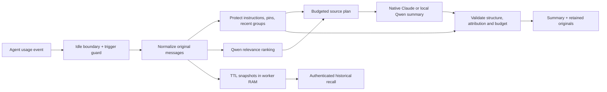

# Architecture and release boundaries

## Separate responsibilities

`core.py` chooses message groups, enforces declared retention and validates final memory. Models do not control which protected messages disappear. `rankers.py` implements the actual relevance checkpoint. `providers.py` uses a distinct generative checkpoint locally, or the authenticated Claude CLI in isolated no-tools mode for standalone summarization.

The Claude mod calls native compaction with selected original message handles. It does not patch a transcript file or treat shell-hook stdout as a replacement. The native summarizer remains the LLM supplied by the agent. The standalone playground does not modify an agent session.

`server.py` is a loopback TLS worker. It serializes inference, rejects oversized/malformed requests, applies a ten-per-minute inference limit, validates Host and Origin and holds at most16 original snapshots for60minutes in RAM. Its public health identity lets the launcher distinguish its own worker from a process already occupying the port. Tokens/passwords are generated per launch, process-scoped and absent from source/configuration. The encrypted certificate key and merged CA bundle are removed on launcher teardown.

The portfolio website is a static explanation and recorded benchmark explorer. Arbitrary-input inference runs in the separate local playground. The hosted site has no model backend, transcript upload service or browser-storage cache. A browser WebMCP replay action mirrors the visible controls where supported; native WebMCP support is optional.

## Trigger and budgets

- Default trigger70%, aim40%, safe turn boundary, one-minute cooldown,10-point hysteresis.
- Agent usage is authoritative for triggering. Unknown stays unknown.
- Conversation target is capped200k; system prompt/tool overhead is not counted here.
- The source selection allowance, summary allowance, protected original size and final memory allowance are explicit, separate quantities.
- Budget refusal leaves standalone context untouched. Claude falls back to native compaction where custom selection cannot be applied. A native summary error skips rather than re-invoking the LLM.

Qwen counts are exact text encoding counts for that tokenizer plus a declared message framing allowance. They do not become exact Claude tokens. The adapter adds a conservative UTF-8 guard before custom replacement. These accounting boundaries are included in every measured artifact.

## Things code cannot guarantee

The baseline conservatively protects ordinary user text and explicitly pinned facts/tasks. It does not perfectly extract implicit instructions or unresolved decisions. Reranker scores are relevance ordering, not calibrated loss risk. Source IDs establish provenance identity, not semantic faithfulness. An LLM can still misstate evidence. After compaction, follow-up questions can retrieve original snapshots while the worker is alive; a durable encrypted archive is out of scope for v0.1.

## Evaluation and roadmap

The first evaluation measures synthetic QA retention, exact field checks, abstention, budget compliance and elapsed time. It does not claim coding-task success. The default all-user preservation policy and the controlled pin-only experiment are distinct. Failures remain in the end-to-end denominator.

Next: real task replay with tests; repeated-compaction drift; explicit protected-recency ablation; ranking calibration; a separately evaluated Laya unresolved-decision classifier; OpenCode adapter; Codex adapter only when a documented replacement capability exists; durable encrypted retrieval.

## Guidance used

Implementation consulted Seezo topics `genai/model-input-output-controls`, `authentication/tokens`, `api/security`, `data-protection/sensitive-data`, `secrets/handling` and `validation/csp`. Relevant controls were applied to new input, transport, storage, secret and browser surfaces. Optional mechanisms from those topics were not added where the prototype has no corresponding surface.
